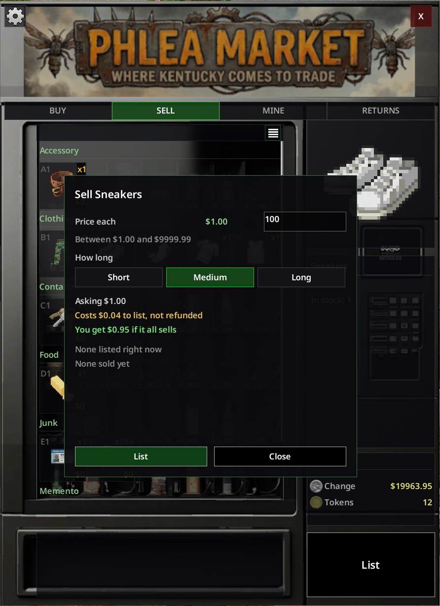

# Phlea Market

A Project Zomboid (B42) mod that adds a vending machine stocking itself from other players'
pockets. Hand it something, name a price, and it holds that item in escrow until somebody
buys it or the clock runs out.

> **Requires:** [PhunMart 2](https://steamcommunity.com/sharedfiles/filedetails/?id=3689006725). This mod does nothing on its own.
> **Build:** Project Zomboid B42, singleplayer or multiplayer.

---

## For players

The machine has four tabs along the top.

### Buy

One tile per kind of item, showing the cheapest anybody is asking and how many are to be
had. Open one to see the individual listings underneath it, ordered cheapest first and then
oldest first, so two sellers asking the same price are served in the order they listed.

Double click a tile to open it, or a listing to buy it. A listing holding more than one asks
how many, with an **All** button, and shows the running total against your balance before
you commit.

The strip above the grid narrows things down. The dropdown lists only categories something
is actually listed in, with counts. The search box matches item names, and starting it with
an `@` searches sellers instead, so `@steve` finds everything Steve has up.

### Sell

Everything in your bags that may be listed, one row per kind of item. Pick one, name a price
per item, choose how many and how long to list it for.

The dialog shows what the market is currently asking for that item, what it has recently
sold for, and what you asked last time you listed one. It opens at that last price. It also
shows the listing fee and what lands in your wallet if the lot sells, worked out with the
same arithmetic the server charges with.

Your item leaves your inventory the moment you list it.

### Mine

What you have up, with the time remaining on each. Cancel returns the goods to your Returns
tab. The listing fee is not refunded, which is what stops the market filling with listings
nobody meant to keep.

### Returns

Expired listings, cancelled ones, and any money that would not fit in your wallet when
something sold. Collect it from any Phlea Market.

### Things worth knowing

**Items keep their condition.** A 12% axe sells as a 12% axe and comes back as one. That is
the difference between a market and a repair bench.

**Magazines, attachments and bag contents are handed back to you when you list something,**
rather than travelling with it. The confirmation says exactly what will be removed before
anything moves.

**A stack is one listing.** A hundred shotgun shells is one listing with a price per shell,
not a hundred listings. This works for any items that are identical to each other right now.
If two of your shells differ, they are simply left out of the stack.

**Everything belongs to your account, not your character.** Dying does not forfeit an
escrowed axe: it was already out of the world when the character died. A new survivor picks
up the same listings, the same returns and the same per account listing limit.

**You are told when something sells.** Straight away if you are online, and with a summary
when you next log in if you were not.

**You can buy your own listing.** It costs you the commission, so it is a worse Cancel, but
it is there.

---

## For server owners

### Settings

Twenty two options on their own **Phlea Market** sandbox page. Every one carries a tooltip
in game, so this is the shape of them rather than a list.

| Group                          | What it controls                                                                                                                                |
| ------------------------------ | ----------------------------------------------------------------------------------------------------------------------------------------------- |
| **Enable / Simulated sellers** | The master switch, and whether the market stocks itself with listings from survivors who do not exist.                                          |
| **Durations**                  | Three tiers (short, medium, long) in in game hours, each with its own listing fee multiplier. Set all three the same for a single fixed length. |
| **Listing fee**                | Charged when a listing goes up and never refunded. A percentage of the asking total or a flat amount, with an optional floor.                   |
| **Commission**                 | Taken from the seller's proceeds on each sale. A percentage or a flat amount. This is the main currency sink.                                   |
| **Limits**                     | Listings per account, largest stack in one listing, and the price floor and ceiling.                                                            |
| **Housekeeping**               | How long uncollected returns survive, and how many entries the admin ledger keeps.                                                              |

Fees are worked out when a listing goes up and frozen onto it. A seller sees their exact
take home before confirming, and changing a setting later cannot reach back and tax
something already on the shelf.

### The economy levers that matter

**Commission is where money leaves the world.** Every sale destroys that share. If your
server is inflating, this is the dial.

**The listing fee is a brake on clutter,** not a revenue stream. A percentage is usually
right: a flat fee asks the same to list one nail as to list a gold bar. The floor exists
because a percentage of a very cheap listing rounds down to nothing, which makes the
cheapest listings free exactly where spam is cheapest.

**Sale proceeds respect the wallet cap.** What fits is paid, and the rest waits in the
seller's Returns until they have room. Without that, two players passing one item back and
forth could lift a balance past the ceiling indefinitely, and every earn rate in PhunMart is
set against that ceiling holding.

**Price limits stop the market being used as storage.** A listing nobody can afford is a
free bank vault, and the ceiling plus a percentage listing fee makes that expensive.

### Simulated sellers

Off by default. Turned on, the market keeps a target number of listings up from survivors
who do not exist.

Their stock is drawn from what PhunMart's own machines sell, at prices around what those
machines charge, so whatever you have priced a hammer at is roughly what a hammer goes for
here. That holds even on a server that has rewritten every price in the game. Prices land
between about two thirds and one and a half times the machine price, so the market reads as
a spread of good and bad deals rather than a second price list.

Buying from one still costs you the money. Nobody is paid, because there is nobody behind
the name.

Useful in singleplayer, where there is otherwise nobody to trade with, and on a quiet server
where a market that is technically live and practically empty is worse than no market.

### Moderation

The **Listings** tab in PhunMart's admin window (the cog on any machine) shows everything on
the market, sortable by any column and searchable by item, seller, type or status.

**Pull listing** takes something off sale and returns the goods to whoever listed them. It
does not confiscate.

The **Ledger** tab records every listing, sale, cancellation, expiry and collection, newest
first, with who did it and what changed hands. It is capped and rolls over. This is what
settles an argument about who was paid what, and it has been recording since the first
listing, so the answer is already there when somebody asks.

### What cannot be sold

PhunMart currency, the dropped wallet, the vehicle key spawner and corpses are blocked
outright. Server owners can block more by exact item type, by display category (so "no food"
is one entry rather than hundreds) or by item tag.
